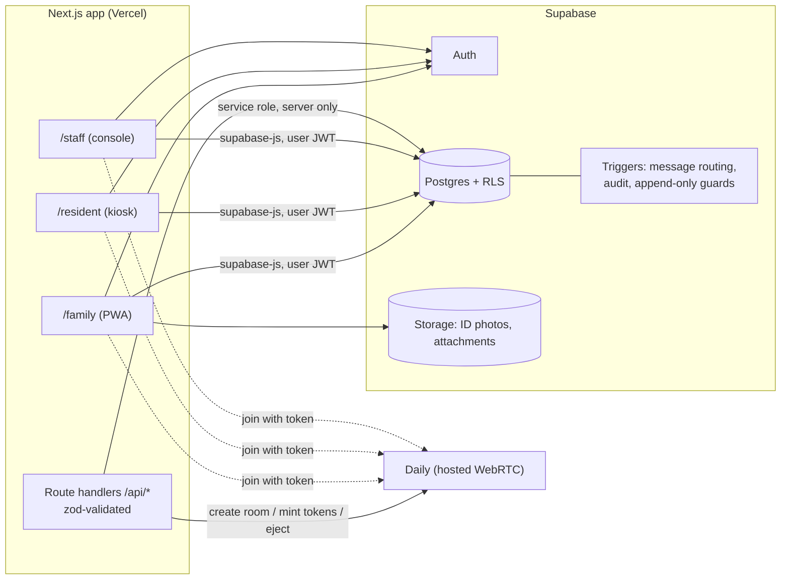

# Kinline MVP — Plan (awaiting approval)

Name lives in one config value: `NEXT_PUBLIC_APP_NAME`.

## 1. Architecture

- Browser talks to Supabase with the user's JWT; RLS is the enforcement layer.
- Service role key is used only in route handlers (resident login, video room/token, CSV export, seed).
- Video: Daily rooms created server-side at approval/start; short-lived tokens per participant; staff get an owner token (watch, eject, end).

## 2. Key decisions (flag if you disagree)

| Topic | Decision |
|---|---|
| Video provider | **Daily** (simplest SDK, REST eject/delete room, easy staff "watch" via owner token). |
| Resident login | Supabase Auth user with synthetic email `<booking>@r.<facility_slug>.invalid`; password = PIN. Kiosk is bound to a facility via a facility code in the URL. 6-digit min PIN, lockout after 5 fails (staff reset). |
| Roles/tenancy | `users.role` + `users.facility_id`; RLS uses `security definer` helpers `auth_facility()` / `auth_role()`. |
| Message routing | **DB trigger** on insert decides `held` vs `delivered` from facility setting + keyword match, so clients can't bypass. Keyword hit always forces `held` + `flagged`. |
| Audit log | Insert only via triggers / `log_action()` security-definer fn; `UPDATE/DELETE/TRUNCATE` blocked by trigger and revoked. Staff can only SELECT own facility. |
| Pricing hook | `pricing.ts` with `getMessageFee(ctx) => 0`, called at send; no schema coupling yet. |
| Recording hook | `visits.recording_url` null + comment in `video/session.ts` where Daily recording would be enabled. |
| ID photo | Private bucket, path `<facility>/<user>/id.*`; readable only by owner + same-facility staff; signed URLs, 60s. |

## 3. Data model (all tables have `facility_id`, RLS on)

- `facilities` (id, name, slug, settings jsonb: `hold_all_messages`, `max_visit_minutes`, `max_visits_per_week`)
- `users` (id = auth.uid, facility_id, role enum `family|resident|staff|admin`, email, phone, full_name, status `active|suspended`)
- `residents` (id, facility_id, user_id, booking_number unique per facility, full_name, housing_unit, comms_suspended bool, pin_failures)
- `connection_requests` (id, facility_id, family_user_id, resident_id, relationship, id_photo_path, status `pending|approved|denied`, decided_by, decided_at, deny_reason)
- `contacts` (id, facility_id, resident_id, family_user_id, status `active|blocked`, created_from_request) — the approved link
- `messages` (id, facility_id, contact_id, direction `in|out`, body, attachment_path, status `held|delivered|rejected`, flagged bool, flag_reasons text[], created_at)
- `message_reviews` (id, facility_id, message_id, staff_id, action `approve|reject|flag`, reason, created_at)
- `visit_slots` (id, facility_id, starts_at, ends_at, capacity)
- `visits` (id, facility_id, contact_id, slot_id, status `requested|approved|denied|live|ended|cancelled`, daily_room, started_at, ended_at, ended_by, recording_url null)
- `flag_keywords` (id, facility_id, word, created_by)
- `audit_log` (id bigserial, facility_id, actor_id, actor_role, action, entity, entity_id, detail jsonb, created_at)

Resident visibility: a resident sees only `contacts` where `status='active'` and `resident_id` is theirs; messages/visits inherit via `contact_id`. Family sees only rows via their own `contacts`.

## 4. Build order (each step runs end to end before the next)

1. **Scaffold + auth + roles** — Next.js/Tailwind/PWA shell, Supabase local (CLI), migrations for users/facilities/residents, family signup, resident kiosk login, staff login, role-routed layouts. RLS tests (pgTAP).
2. **Connection approvals** — family request + ID upload, staff queue, approve/deny → `contacts`. Audit triggers start here.
3. **Messaging + review queue** — send/receive, routing trigger, keywords, approve/reject/flag, attachments. Vitest + pgTAP for review flow.
4. **Staff console** — dashboard, resident profile, block contact, suspend resident, keyword + settings admin.
5. **Video visits** — slots, request/approve, Daily room + tokens, join, staff watch/end, metadata only.
6. **Audit export** — filters + CSV (server route, facility-scoped).
7. **Seed, demo script, README** (facility, 2 staff, 5 residents, 5 families, sample messages/visits; all fake).

Tests: pgTAP per policy (cross-family read, resident vs unapproved contact, cross-facility staff, audit immutability); Vitest for routing trigger/review flow; no E2E in MVP beyond a manual demo script.

## 5. Questions before I start

1. **Supabase:** OK to use the local Supabase CLI (Docker) for dev now and create the cloud project later with you? Creating a cloud project can incur cost, so I won't do it without your say.
2. **Daily vs LiveKit:** Daily OK? You'll need to provide a Daily API key later (env var only).
3. **Framework versions:** latest Next.js App Router + Tailwind. OK?
4. **Spec for "Staff approve the visit":** can staff also pick/edit the time, or only approve/deny the family's requested slot? I'll assume approve/deny only.
5. **Resident PIN:** set by staff at intake (staff generates one-time PIN, resident changes on first login)? I'll assume yes.
