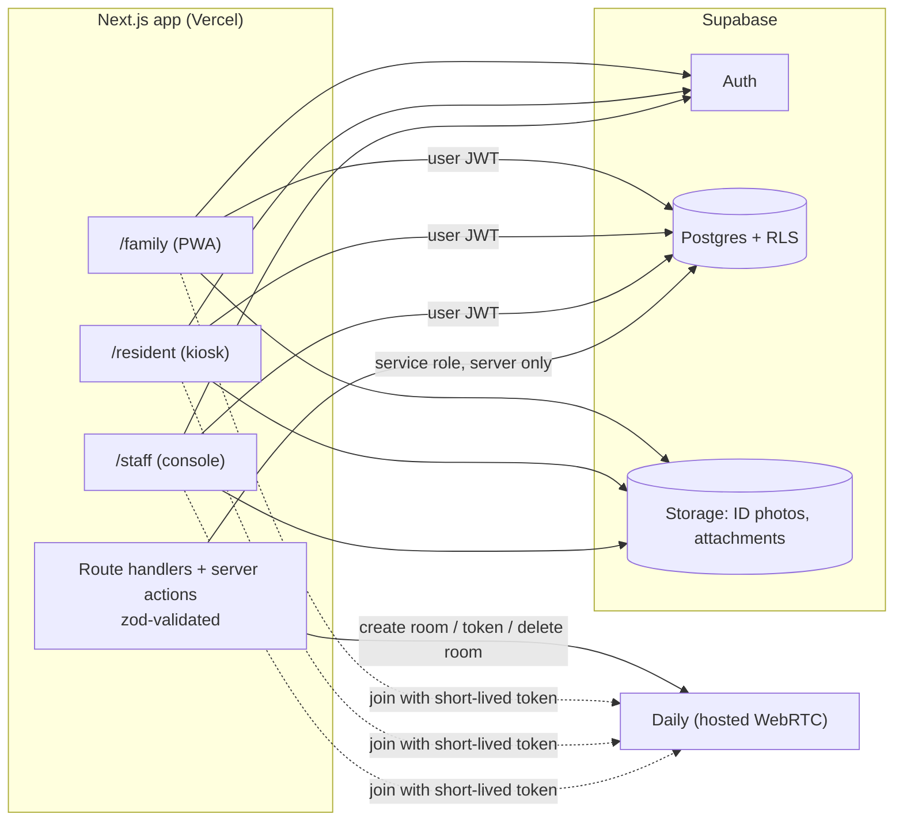

# Kinline

A demo-ready MVP of a correctional communications platform: families and residents (incarcerated people) exchange
reviewed messages and scheduled video visits, and facility staff approve, monitor and audit everything.

The buyer is the facility, not the family, so the product is built around staff control: connection approvals,
message review, keyword flagging, live visit monitoring, and an append-only audit log.

> **Demo software.** All people, booking numbers and facilities in the seed data are fictional. Not for production
> use without the items under [What production would need](#what-a-production-version-would-need).

The product name is a placeholder; rename it with one value: `NEXT_PUBLIC_APP_NAME`.

## What's in the MVP

| Area | What works |
|---|---|
| Accounts | Family sign-up with ID photo upload (stored, not verified); resident kiosk login (booking number + PIN, lockout after 5 failures, forced PIN change on first login); staff and admin accounts |
| Connections | Family requests a resident by name + booking number; staff approve/deny; residents only ever see approved contacts |
| Messaging | Text + family photo attachments; every message is held for review *or* auto-delivered and logged (facility setting); keyword hits are always held; approve / reject (with reason) / flag; per-message fee hook (always 0) |
| Video visits | Staff publish slots; families request; staff approve; weekly-limit and capacity enforcement; browser video via Daily; staff can watch silently and end any live visit; metadata only |
| Staff console | Dashboard, residents (intake, PIN reset, block contact, suspend), settings, keywords, staff accounts (admin), filterable/exportable audit log |

Out of scope (not built): phone calls, payments, commissary, media store, native apps, real ID verification,
multi-facility billing, jail-management-system integration.

## Architecture



Security model, in short:

- **Row Level Security on every table.** The browser talks to Postgres with the user's JWT. Families see only their
  own rows, residents only approved contacts, staff only their facility.
- **Writes go through `security definer` functions** (`send_message`, `request_connection`, `decide_visit`, …) that
  re-check role, facility, contact status and suspension. Clients have no direct INSERT/UPDATE/DELETE on any
  business table.
- **Message routing happens in the database**, not the client, so a client cannot choose to skip review.
- **Audit log is append-only**: written only by trusted functions, with update/delete/truncate blocked by triggers.
- `facility_id` is on every record (multi-tenant ready).
- Role and facility live in `app_metadata`, which clients cannot edit; public Auth sign-up is disabled and accounts are
  created by server routes only.
- No secrets in client code; the service-role key is only imported by server-only modules.

## Local setup

Requirements: Node 20+, Docker (for local Supabase).

```bash
npm install
npx supabase start            # first run pulls images (a few minutes)
cp .env.example .env.local    # then fill in the keys printed by `npx supabase status -o env`
npm run db:reset              # applies migrations + seeds demo data
npm run dev                   # http://localhost:3000
```

`.env.local` values for local development:

| Variable | Value |
|---|---|
| `NEXT_PUBLIC_APP_NAME` | Display name (default `Kinline`) |
| `NEXT_PUBLIC_DEFAULT_FACILITY` | Facility slug used by sign-up and the kiosk (`demo-county`) |
| `NEXT_PUBLIC_SUPABASE_URL` | `http://127.0.0.1:54321` locally |
| `NEXT_PUBLIC_SUPABASE_ANON_KEY` | `ANON_KEY` from `supabase status` |
| `SUPABASE_SERVICE_ROLE_KEY` | `SERVICE_ROLE_KEY` from `supabase status`. **Server only** |
| `DAILY_API_KEY` | Daily API key (server only). Without it the app runs but the video join page shows "Video is not set up yet" |
| `DAILY_API_URL` | Optional override of the Daily REST base URL (used by tests) |

### Demo accounts (password `DemoPass!234`)

| Role | Login |
|---|---|
| Admin | `admin@demo-county.test` |
| Staff | `staff@demo-county.test` |
| Family | `family1@example.test` … `family5@example.test` |
| Resident kiosk | `/resident/login`, booking `DEMO-1001` … `DEMO-1005`, PIN `123456` |

See [DEMO.md](DEMO.md) for the 5-minute walkthrough.

### Video

1. Create a Daily account and an API key; put it in `DAILY_API_KEY`.
2. Rooms are created on demand, private, expiring after the slot, with no chat or screen share. Participants join
   with short-lived tokens. Staff "watch" uses a hidden, receive-only token; "End visit" deletes the room (ejecting
   everyone) and records who ended it.
3. The provider sits behind `src/lib/video/provider.ts`; swapping in LiveKit Cloud means one new file.
4. Recording is intentionally not enabled. The place to add it is marked in `src/lib/video/daily.ts`
   (`createRoom`) and `visits.recording_url`.

## Tests

```bash
npm run test:db     # pgTAP: every RLS policy, the message review flow, visit rules, audit immutability
npm run test:int    # starts the app against a fake Daily API: join/watch/end rules, CSV export, approval flows
```

Run `npm run db:reset` first: the integration tests use (and modify) the seed data.

## Deploying

1. **Supabase cloud:** create a project; `npx supabase link --project-ref <ref>` and `npx supabase db push`.
   In Authentication settings keep sign-ups **disabled** and require email confirmation if you later open sign-up.
   Create the first facility and admin with a one-off script modeled on `scripts/seed.ts` (do **not** run the demo seed
   against production).
2. **Vercel:** import the repo; set `NEXT_PUBLIC_SUPABASE_URL`, `NEXT_PUBLIC_SUPABASE_ANON_KEY`,
   `SUPABASE_SERVICE_ROLE_KEY`, `NEXT_PUBLIC_APP_NAME`, `NEXT_PUBLIC_DEFAULT_FACILITY`, `DAILY_API_KEY`.
3. Add the production URL to Supabase Auth redirect settings. Deploy.

## Project layout

```
supabase/migrations/   schema, RLS, functions (one file per build step)
supabase/tests/        pgTAP tests
src/app/{family,resident,staff}/   role-specific UIs
src/app/api/           resident login, family sign-up, visit join/end, audit export
src/lib/               supabase clients, auth guard, video provider seam, pricing hook, audit helpers
scripts/seed.ts        demo data (fictional)
tests/integration/     vitest + fake Daily server
```

## What a production version would need

- **CJIS-style security review** and a third-party penetration test; encryption-at-rest and key management review;
  SSO/MFA for staff; session policies; managed device (kiosk) lockdown; network allow-lists; incident response.
- **Recording and retention policy:** whether to record, where, for how long, who may access, legal holds, and
  disclosure to participants. Provider-side recording must be wired in.
- **Identity verification:** real ID verification (currently photos are stored for staff to look at); email/phone
  verification; account recovery.
- **Phone calls (PSTN)** and the associated carrier arrangements.
- **State telecom compliance:** tariff and rate rules, free-communication requirements, consent and call-monitoring
  notices, attorney-client privileged communication handling.
- **Accessibility audit** (WCAG, screen readers, tablet hardware, low-literacy and multilingual support).
- **Operations:** scheduled jobs for visit expiry and retention (the MVP closes stale visits opportunistically),
  rate limiting and abuse protection at the edge, realtime updates instead of polling, monitoring and alerting,
  backups and disaster recovery, per-facility time zones, content moderation for photos.
- **Integrations:** jail management system sync (residents, housing, releases and transfers); payment and pricing
  (hook: `src/lib/pricing.ts` and `messages.fee_cents`).
