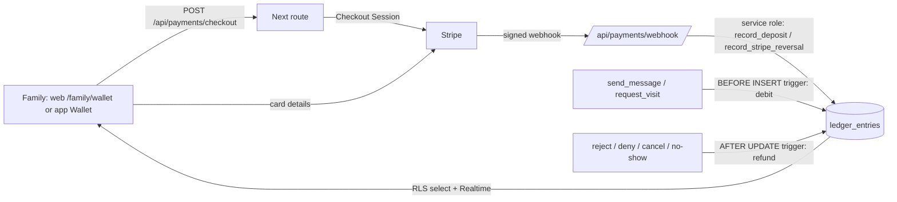

# Payments

Families keep a prepaid **balance**. Each facility sets its own prices for family messages and video visits. Fees
are charged by the database in the same transaction as the message or visit, and refunded automatically when the
service doesn't happen. Money comes in through **Stripe Checkout** on the website; the mobile apps show the balance
and, only where the store rules allow it, link out to the same checkout.

Status: built and tested in **Stripe test mode**. All prices default to 0, so nothing is charged until a facility
admin sets prices. **Before charging real money, work through [Compliance](#compliance-verify-per-facility-before-charging)
and [Open questions](#open-questions-for-counsel).**

## Architecture



| Piece | Where |
|---|---|
| Ledger, rate card, charging, refunds, Stripe functions | `supabase/migrations/20261108000003_payments.sql` |
| Stripe client (server only) | `src/lib/stripe.ts` |
| Checkout (cookie **or** Bearer auth) | `src/app/api/payments/checkout/route.ts` |
| Webhook (signature-verified) | `src/app/api/payments/webhook/route.ts` |
| App return hop (`https` → `kinline://wallet`) | `src/app/api/payments/app-return/route.ts` |
| Web wallet | `src/app/family/(app)/wallet/` |
| Staff rate card | `src/app/staff/(app)/settings/` |
| Mobile wallet, purchase-mode flag | `mobile/src/app/wallet.tsx`, `mobile/src/lib/payments.ts` |
| Shared amounts and labels | `shared/payments.ts` |
| Tests | `supabase/tests/database/07_payments.test.sql`, `tests/integration/payments.test.ts`, `tests/integration/fake-stripe.ts` |

### Ledger (source of truth)

- `ledger_entries` is append-only: triggers block `update`, `delete` and `truncate` (same pattern as `audit_log`).
  Corrections are new rows. `family_user_id` is `on delete restrict`, so financial history outlives accounts.
- Balance = `sum(amount_cents)` for the user (`my_balance()`). There is no balance column to drift.
- Kinds: `deposit` (+), `message_fee` (−), `visit_fee` (−), `refund` (reverses an entry; `refund_of` points at it),
  `adjustment` (card refund failures and disputes).
- `facility_id`: fees → the **resident's** facility (the one that set the price); deposits → the family member's
  **home** facility. One balance per family member, usable at every facility they're connected to.
- Idempotency: unique `(kind, reference)` and unique `stripe_event_id`. One fee per message/visit
  (`message:<id>`, `visit:<id>`), one refund per fee, one deposit per PaymentIntent (`pi_…`), one entry per Stripe
  refund/dispute movement (`re_…`, `du_…:withdrawn`). Replayed webhooks return `duplicate` and change nothing.
- Concurrency: every write takes a per-user advisory lock, so two simultaneous sends can't spend the same funds.
- Every ledger row is also written to `audit_log` (`ledger.deposit`, `ledger.message_fee`, …) via `log_action`.
  Webhook entries are attributed to the family member.

**Who can read/write**

| | Read | Write |
|---|---|---|
| Family | own rows (RLS), `my_balance()`, `contact_prices(contact)` | none directly; fees happen via `send_message` / `request_visit` |
| Staff | rows whose `facility_id` is their facility | none (prices via settings) |
| Resident | nothing | none |
| Service role | all | `record_deposit`, `record_stripe_reversal` only (called by the webhook) |

Internal functions (`ledger_post`, `ledger_refund`, `wallet_balance`, `rate_card`, trigger functions) are not
executable by `anon` / `authenticated`.

### Prices (rate card)

Stored in `facilities.settings` and validated by the existing `facility_settings_valid` check constraint. Missing
keys mean 0.

| Key | Meaning | Sanity limit |
|---|---|---|
| `message_fee_cents` | Per family message | 0–500 |
| `free_messages_per_week` | Free family messages per family member per facility per week (Monday start, database time zone; rejected messages don't count) | 0–500 |
| `visit_fee_cents` | Per video visit request | 0–5000 |

The limits are guard rails against typos, **not** legal rate caps. Admins edit prices on **/staff/settings**
(in dollars); changes are audited by the existing `facility.settings_update` trigger and apply only to new
messages and visit requests. Resident-sent messages are never charged.

### Charging

`BEFORE INSERT` triggers on `messages` and `visits` compute the fee from the resident facility's rate card, set
`fee_cents`, check the balance and write the debit, all inside the `send_message` / `request_visit` transaction.
RPC signatures are unchanged, clients can't insert those tables, and `fee_cents` can't change after insert. If
the balance is short the call fails with:

```
code P0001, message "insufficient balance; add funds to continue"
```

Web and app detect this (`isInsufficientBalance` in `shared/payments.ts`) and offer "Add funds" / "View balance".
Prices are shown next to the compose box and the visit request form (`contact_prices`).

### Refund rules

Refunds are new `refund` rows (never deletions), written by `AFTER UPDATE` triggers:

| Event | Refunded? |
|---|---|
| Message **rejected** by staff | Yes |
| Message held, then approved / flagged | No (delivered or still pending) |
| Visit **denied** | Yes |
| Visit **cancelled** by the family or staff | Yes |
| Visit **expired** (never decided before its start) | Yes |
| Visit approved but **no-show** (nobody joined before the end) | Yes. We can't tell whose fault it was; a facility could choose otherwise later (counsel/contract question) |
| Visit went **live** and ended (on time or ended by staff) | No |

Free messages carry no fee, so nothing is refunded for them.

### Stripe deposits (web)

1. The family picks a fixed amount ($10, $25, $50; `DEPOSIT_AMOUNTS_CENTS`). `POST /api/payments/checkout`
   authenticates the cookie **or** `Authorization: Bearer` (via `getRequestAuth`), requires an active family
   account, and creates a Checkout Session with `metadata` and `payment_intent_data.metadata` =
   `{ user_id, facility_id, kind: "deposit" }` and an idempotency key `deposit:<user>:<amount>:<request_id>`.
2. The family pays on Stripe's page. **No card data touches Kinline servers or the apps.**
3. `POST /api/payments/webhook` verifies the `Stripe-Signature` against the raw body, then:

| Event | Effect |
|---|---|
| `checkout.session.completed`, `checkout.session.async_payment_succeeded` (only when `payment_status = paid`) | `deposit` (+) and a "Funds added" push (fixed text, no amount) |
| `refund.created` (not `canceled`) | `refund` (−) of the refunded amount, linked to the deposit |
| `refund.failed` | `adjustment` (+) putting the money back |
| `charge.dispute.funds_withdrawn` | `adjustment` (−) |
| `charge.dispute.funds_reinstated` | `adjustment` (+) |
| anything else | ignored (200) |

   Handler errors return 500 so Stripe retries; every handler is idempotent. Card refunds and disputes can make a
   balance negative; fees are then blocked until it's topped up.
4. The wallet page refreshes over Realtime when the ledger row lands (polling as a fallback).

Refunds to a card are issued from the Stripe Dashboard; the webhook records them. There is no in-app "refund my
balance to my card" flow yet (see open questions).

### Mobile

- **Wallet** screen (`/wallet`, from Account → Balance, deep link `kinline://wallet`, and the "Funds added" push):
  balance, history over RLS, Realtime refresh, refetch when the app returns to the foreground.
- Insufficient-balance states in the thread composer and the visit request form, with a "View balance" link, and
  prices shown inline.
- Purchasing is a **build-time flag per platform**, off by default (`mobile/src/lib/payments.ts`):

| Flag | Value | Behaviour |
|---|---|---|
| `EXPO_PUBLIC_IOS_EXTERNAL_PURCHASE_LINK` | `us` | "Add funds" buttons call the checkout API (`return_to: "app"`) and open Stripe Checkout in **Safari** via `Linking.openURL` (not a WebView or in-app browser). Stripe returns to `https://…/api/payments/app-return`, which redirects to `kinline://wallet`. |
| (unset) | | Text only: "You can add funds on the Kinline website…" No link, no button. |
| `EXPO_PUBLIC_ANDROID_EXTERNAL_PURCHASE_LINK` | `us` | Same as iOS. **Leave unset** until counsel confirms Google Play's rules. |

  The app never holds Stripe keys; it only calls our API with the user's Supabase access token.
- **Seam for store billing:** a `store_billing` purchase mode (StoreKit / Play Billing) would verify purchases on
  the server and post `deposit` rows from a store notification handler, exactly like the Stripe webhook. Not
  implemented.

## Store-policy decision (per platform)

This is the engineering default, **not legal advice**; store rules and court-ordered changes keep moving. Verify
against the current App Review Guidelines and Google Play Payments policy before enabling anything. Background:
[`mobile/PAYMENTS-POLICY.md`](mobile/PAYMENTS-POLICY.md).

| | Web | iOS, US storefront | iOS, elsewhere | Android |
|---|---|---|---|---|
| Add funds | Stripe Checkout | External link to Stripe Checkout behind `EXPO_PUBLIC_IOS_EXTERNAL_PURCHASE_LINK=us` | Website text only | Website text only (flag available, off) |
| See balance / history | Yes | Yes | Yes | Yes |

**Paid video visits and guideline 3.1.3(d).** Apple lets apps use payment methods other than in-app purchase for
*real-time person-to-person services between two individuals*. A Kinline video visit is a live one-to-one call
between a family member and a resident, so the visit fee itself plausibly qualifies. **Conclusion:** we do not
rely on 3.1.3(d) yet, because the balance is a single prepaid wallet that also pays for **messages**, which are
asynchronous and therefore not covered (Apple treats non-real-time person-to-person services as digital content
under 3.1.1). Options if counsel wants to use 3.1.3(d): a visit-only payment at booking time (Stripe Payment Sheet
in the app, no wallet), or a separate visit-only balance. Either is a contained change in `request_visit`'s
charging trigger and the checkout route.

**Before turning on the iOS link:** confirm (1) the build is distributed only on the US storefront, or add a
storefront check, since the link is not allowed in most other countries; (2) whether Apple now requires an
entitlement, a specific button style/placement or parity with in-app purchase, and any commission on linked-out
purchases, and implement that in `mobile/src/lib/payments.ts` and `app.config.ts`. No entitlement keys are
added yet, deliberately: we didn't want to encode guesses.

## Setup

**Environment** (server only; see `.env.example`):

| Var | Notes |
|---|---|
| `STRIPE_SECRET_KEY` | `sk_test_…` until launch. Without it the wallet says adding funds isn't available; everything else works. |
| `STRIPE_WEBHOOK_SECRET` | `whsec_…` from the webhook endpoint (or from `stripe listen` locally). |
| `PUBLIC_APP_URL` | Optional. Origin used for success/cancel URLs; defaults to the request origin. |
| `STRIPE_API_BASE` | Tests only (fake Stripe server). Never set in production. |

Mobile: `EXPO_PUBLIC_IOS_EXTERNAL_PURCHASE_LINK`, `EXPO_PUBLIC_ANDROID_EXTERNAL_PURCHASE_LINK` (see above;
`mobile/.env.example`).

**Stripe Dashboard (test mode first)**

1. Developers → API keys: copy the **test** secret key into `STRIPE_SECRET_KEY` (Vercel: Production/Preview env,
   server only). No publishable key is needed; Checkout is hosted by Stripe.
2. Developers → Webhooks → Add endpoint: `https://<your-domain>/api/payments/webhook`. Events:
   `checkout.session.completed`, `checkout.session.async_payment_succeeded`, `refund.created`, `refund.failed`,
   `charge.dispute.funds_withdrawn`, `charge.dispute.funds_reinstated`. Copy the signing secret into
   `STRIPE_WEBHOOK_SECRET`.
3. Settings → Branding / Checkout: business name and support contact as families will see them.
4. Local development:

```bash
stripe listen --forward-to localhost:3000/api/payments/webhook
```

   Use the `whsec_…` it prints as `STRIPE_WEBHOOK_SECRET`, then pay with test card `4242 4242 4242 4242`.

Stripe was added with the official `stripe` npm SDK. (The Vercel Marketplace Stripe integration can provision
the same env vars; it isn't required.)

**Set prices:** sign in as a facility admin → Settings → Prices.

## Testing

```bash
npm run test:db      # pgTAP, includes 07_payments (ledger immutability, RLS, charging, refunds, lockdown, Stripe functions)
npm run test:int     # integration, includes payments.test.ts against a fake Stripe server
```

`npm run test:int` starts the app with `STRIPE_SECRET_KEY=sk_test_kinline_integration`,
`STRIPE_WEBHOOK_SECRET=whsec_kinline_integration` and `STRIPE_API_BASE` pointing at
`tests/integration/fake-stripe.ts`. Webhook tests sign payloads with the SDK's test-header helper, so the real
verification code runs.

## Compliance: verify per facility before charging

Kinline does not encode any of these rules. Each needs a decision, per facility and state, before prices go above 0:

- **FCC rules for incarcerated people's communication services (IPCS).** The FCC's rules under the Martha Wright-Reed
  Act cover audio and video communications and set rate caps and limits on ancillary fees. Confirm which services
  (video visits; whether electronic messaging is covered) and which caps and fee rules apply now.
- **State law.** Several states cap or prohibit charging for correctional communications (some make calls and
  messages free). Check the facility's state.
- **Facility contract.** Revenue share/commissions (some jurisdictions prohibit site commissions), who sets prices,
  and who handles refunds and complaints.
- **Required free communications**: e.g. legal/attorney correspondence, indigent allowances, free weekly visits or
  messages. Today the only tool is `free_messages_per_week`; privileged contacts would need a per-contact exemption.
- **Unused balance**: refund on request, on account closure, or on the resident's release/transfer; state
  unclaimed-property rules; how long balances may sit.
- **Money transmission / stored value**: a prepaid balance usable across facilities may raise money-transmitter or
  prepaid-access questions; confirm the structure (e.g. Kinline as merchant of record for a service credit).
- **Consumer disclosures**: prices shown before purchase, receipts, refund policy, terms of service.
- **Taxes** on communication services, if any, in each jurisdiction.

## Open questions for counsel

1. Do the US App Store link-out terms (entitlement, placement, commission) fit this wallet? Is US-only
   distribution acceptable, or do we need a storefront check / StoreKit?
2. Should visit fees use 3.1.3(d) with a visit-only payment, separate from message credits?
3. Google Play: are outside-payment links for US users allowed for this app category, and at what service fee?
4. Is one wallet across facilities acceptable, or must balances be per facility (contracts, revenue share,
   money-transmission)?
5. No-show refunds: always refund (current), never, or per facility?
6. Refunds of unused balance to the card: on request? automatically on release? within what time?
7. Disputes: should an account be restricted after a chargeback (today only the balance is reduced)?
8. Which facilities and states can charge at all, and at what maximum rates?

## Remaining engineering work

- Staff reporting UI for fees/refunds per facility (data is already readable by staff via RLS).
- Balance refunds to card initiated from Kinline (today: Stripe Dashboard).
- Per-contact fee exemptions (legal correspondence).
- iOS storefront check and any Apple entitlement once the policy decision is made.
